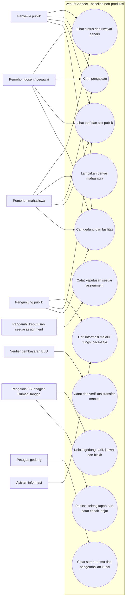
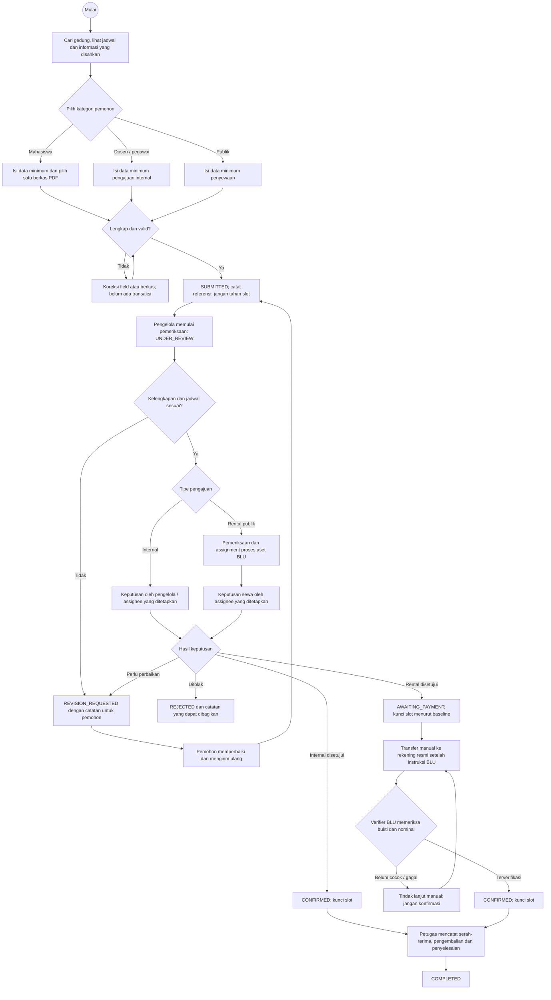
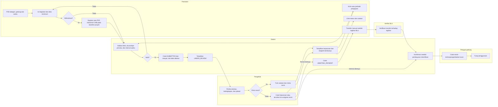
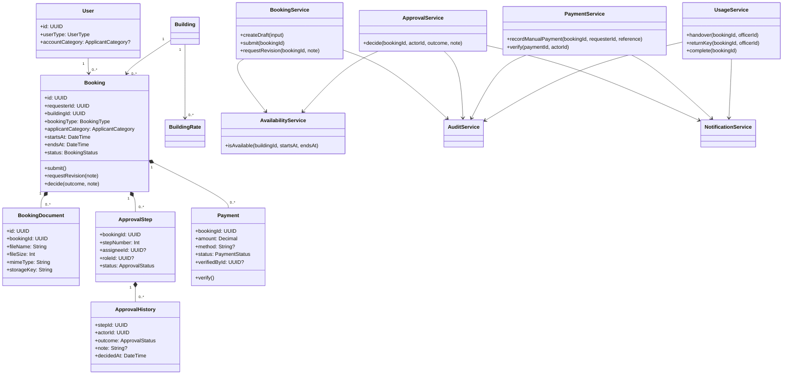

# Baseline Diagram Sistem VenueConnect Polinela

> Versi baseline proyek per 12 Oktober 2026. Diagram direkonsiliasi terhadap proposal FIX, keputusan pengguna untuk task proses 1–9, PRD, dan schema Prisma saat ini. User menyetujui baseline proyek; dokumen ini bukan pengesahan institusi. Produksi tetap nonaktif. Bagian yang belum ada di schema atau memerlukan kewenangan institusi ditandai jelas.

## 1. Use case dan batas sistem



Tidak ada use case mahasiswa untuk approval Wakil Direktur III. Dosen/pegawai dan penyewaan publik tidak diikat ke nama jabatan approver; user/role assignment harus diberikan pemilik proses. Kalender publik hanya mengirim waktu/status umum.

## 2. Flowchart dan activity alur pengajuan

### Pemeriksaan awal dan keputusan bersama



### Activity diagram dengan tanggung jawab



Aturan baseline: mahasiswa tidak diarahkan ke WD III dan keputusan tidak otomatis; Subbagian Rumah Tangga/pengelola mencatat pemeriksaan, catatan, aktor, dan waktu. Hanya `AWAITING_PAYMENT` dan `CONFIRMED` mengunci slot. Nilai jam, kapasitas, durasi, buffer, SLA, expiry, serta siapa assignee aktif harus dikonfigurasi setelah konfirmasi institusi. Prototipe statis tidak mengirim file; UI development kini memakai route upload privat.

## 3. ERD konseptual untuk baseline produk

ERD ini adalah desain konseptual yang mengikuti `backend/prisma/schema.prisma`. `Booking.applicantCategory` dan `User.accountCategory` ada pada schema serta migration yang sudah diterapkan pada PostgreSQL development lokal; kategori akun server membatasi pilihan kategori formulir. Verifikasi identitas saat provisioning akun tetap membutuhkan keputusan institusi.

```mermaid
erDiagram
  USER ||--o{ USER_ROLE : has
  ROLE ||--o{ USER_ROLE : assigned
  USER ||--o{ BOOKING : requests
  BUILDING ||--o{ BOOKING : receives
  BUILDING ||--o{ BUILDING_RATE : prices
  BUILDING ||--o{ BUILDING_FACILITY : offers
  FACILITY ||--o{ BUILDING_FACILITY : included
  BOOKING ||--o{ APPROVAL_STEP : routes
  ROLE o|--o{ APPROVAL_STEP : eligible_role
  USER o|--o{ APPROVAL_STEP : assigned_user
  APPROVAL_STEP ||--o{ APPROVAL_HISTORY : records
  USER ||--o{ APPROVAL_HISTORY : decides
  BOOKING ||--o{ PAYMENT : has
  USER o|--o{ PAYMENT : verifies
  BUILDING ||--o{ BUILDING_BLOCK : blocks
  BOOKING ||--o| USAGE_HANDOVER : handover
  USER ||--o{ USAGE_HANDOVER : officer
  BOOKING ||--o{ BOOKING_STATUS_HISTORY : changes
  USER o|--o{ BOOKING_STATUS_HISTORY : actor
  USER ||--o{ NOTIFICATION : receives
  BOOKING ||--o{ BOOKING_DOCUMENT : attaches
  USER ||--o{ BOOKING_DOCUMENT : uploads
  USER o|--o{ AUDIT_EVENT : acts

  USER {
    uuid id PK
    string email UK
    string name
    enum userType
    enum accountCategory
    boolean isActive
  }
  ROLE {
    uuid id PK
    enum name UK
  }
  USER_ROLE {
    uuid id PK
    uuid userId FK
    uuid roleId FK
  }
  BUILDING {
    uuid id PK
    string slug UK
    string name
    int capacity
    boolean isActive
    boolean publicRentalEnabled
  }
  FACILITY {
    uuid id PK
    string name UK
  }
  BUILDING_FACILITY {
    uuid buildingId FK
    uuid facilityId FK
    string detail
  }
  BUILDING_RATE {
    uuid id PK
    uuid buildingId FK
    string name
    enum audienceType
    decimal amount
    string unit
    datetime validFrom
    datetime validUntil
    uuid approvedById FK
  }
  BOOKING {
    uuid id PK
    uuid requesterId FK
    uuid buildingId FK
    enum bookingType
    enum applicantCategory
    string publicReference UK
    string eventName
    datetime startsAt
    datetime endsAt
    enum status
    json rateSnapshot
  }
  APPROVAL_STEP {
    uuid id PK
    uuid bookingId FK
    uuid assigneeId FK
    uuid roleId FK
    int stepNumber
    enum status
  }
  APPROVAL_HISTORY {
    uuid id PK
    uuid stepId FK
    uuid actorId FK
    enum outcome
    string note
    datetime decidedAt
  }
  PAYMENT {
    uuid id PK
    uuid bookingId FK
    decimal amount
    string currency
    string method
    enum status
    uuid verifiedById FK
    datetime dueAt
  }
  BUILDING_BLOCK {
    uuid id PK
    uuid buildingId FK
    datetime startsAt
    datetime endsAt
    string reason
  }
  USAGE_HANDOVER {
    uuid id PK UK
    uuid bookingId FK UK
    uuid officerId FK
    datetime keyGivenAt
    datetime keyReturnedAt
  }
  BOOKING_STATUS_HISTORY {
    uuid id PK
    uuid bookingId FK
    uuid actorId FK
    enum fromStatus
    enum toStatus
    datetime createdAt
  }
  BOOKING_DOCUMENT {
    uuid id PK
    uuid bookingId FK
    uuid uploadedById FK
    string fileName
    int fileSize
    string mimeType
    string storageKey
  }
  NOTIFICATION {
    uuid id PK
    uuid userId FK
    string type
    string resourceId
    datetime readAt
  }
  AUDIT_EVENT {
    uuid id PK
    uuid actorId FK
    string action
    string entityType
    string entityId
    json metadata
  }
```

Kontrol dokumen harus privat. Isi dokumen tidak dimasukkan ke audit log. Baseline proyek mengusulkan satu PDF maksimal 5 MB dan masa simpan 90 hari sesudah status terminal, tetapi upload, backup, dan penghapusan otomatis tetap nonaktif sebelum sign-off TI/pemilik arsip.

## 4. Diagram kelas dan komponen layanan



`ApplicantCategory` sudah dicantumkan pada schema dan migration development yang diterapkan pada PostgreSQL lokal tanggal 2026-10-12. Use case, alur, ERD, dan class diagram ini telah disejajarkan sebagai baseline proyek; validasi identitas, assignment, serta persetujuan pemilik proses dan TI tetap merupakan gerbang sebelum produksi.
